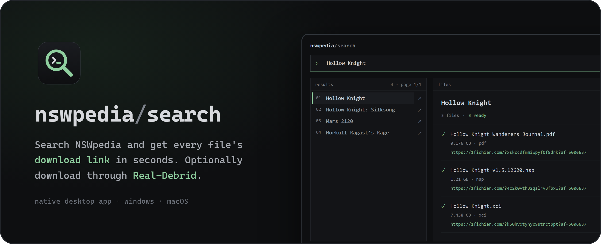
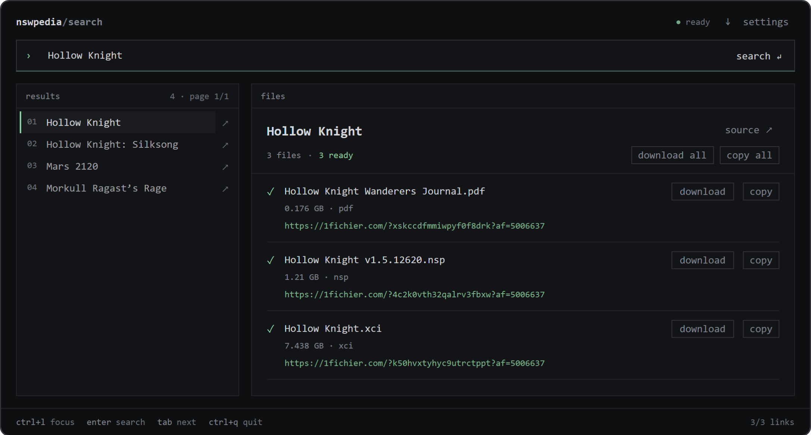
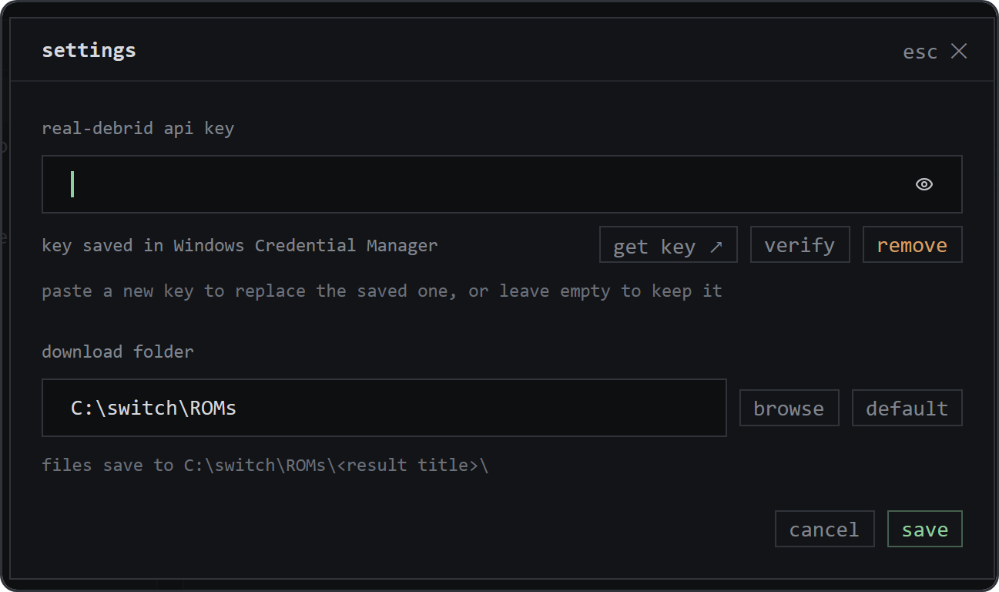

<p align="center"></p>

<p align="center"><strong>A small, fast desktop app for finding Nintendo Switch titles on NSWpedia and collecting their download links.</strong></p>

<p align="center">
  <a href="https://github.com/Skarian/nswpedia-search/releases/latest"><b>Download the latest release</b></a>
  · Windows 10/11 · macOS 15+ (Apple Silicon and Intel)
</p>

Type a title and press Enter. NSWpedia Search finds the matching pages, opens the
first one for you, and turns each file into a direct 1fichier link, with no ad
pages, pop-ups or browser tabs in the way. Copy a link, copy them all, or, if you
have a Real-Debrid account, download the files straight to a folder on your
computer.

It's a native app (Rust), not a website in a wrapper: it starts quickly, keeps
recent lookups in a local cache, and needs nothing else installed.

## Search and get links

Search with **Enter**. Results appear on the left and the first one opens on the
right. Its files are resolved in the background and each one gets a ✓ and its
link as soon as it's ready. Pick another title to see its files, or use
**source ↗** to open the original NSWpedia page in your browser.



- **copy** puts one link on the clipboard; **copy all** copies every ready link.
- Large titles load their files in batches; results you've already resolved stay
  put while more load.
- Lookups are cached for a while (search 15 minutes, file lists 1 hour, links
  12 hours), so going back to a title is instant.
- Keyboard: **Ctrl+L** (⌘L on macOS) jumps to the search box, **Tab** moves
  between controls, **Ctrl+Q** (⌘Q) quits.

## Download with Real-Debrid (optional)

Without an account the app is a link finder. With a
[Real-Debrid](https://real-debrid.com) premium account, it can fetch the files
for you.

1. Open **settings** (top right) and paste your API token from
   [real-debrid.com/apitoken](https://real-debrid.com/apitoken). **verify**
   checks it with Real-Debrid; **save** stores it.
2. Choose a download folder (your Downloads folder by default).
3. Press **download** next to a file, or **download all**.

<p align="center"></p>

The token is kept in your system's password store (Windows Credential Manager or
the macOS Keychain), never in a file, and is only sent to Real-Debrid. Files are
saved to `<download folder>/<title>/<file name>`.

The **↓** button opens the download queue with progress, speed, **cancel**,
**retry** and **show** (in folder). Two files download at a time and the rest
wait their turn. Existing files are never overwritten (a new copy is saved as
`Game (1).nsp`). Interrupted downloads resume where they stopped when you retry
them, or, after a restart, when you download the same file again.

## Install

Get the files from the **[latest release](https://github.com/Skarian/nswpedia-search/releases/latest)**:

| Your computer | Download |
| :--- | :--- |
| Windows 10 or 11 (64-bit) | `nswpedia-search-<version>-windows-x64-setup.exe` (or the `-portable.zip`) |
| Mac with Apple silicon (M1 or later) | `nswpedia-search-<version>-macos-arm64.dmg` |
| Mac with an Intel processor | `nswpedia-search-<version>-macos-x64.dmg` |

These builds are free and unsigned: there's no paid Windows code-signing
certificate and no Apple notarization. Your system warns you the first time you
open the app, and you can approve it once:

**Windows:** run the installer. If SmartScreen says **Windows protected your
PC**, click **More info → Run anyway**. It installs just for you (no
administrator password) and adds a Start menu shortcut. If **Smart App Control**
is on, Windows blocks unsigned apps without offering **Run anyway**; see the
[installation guide](docs/install.md#windows-1011-64-bit).

**macOS:** open the DMG and drag **NSWpedia Search** to **Applications**, then
open it. macOS says it *could not verify* the app; click **Done**. Go to
**System Settings → Privacy & Security**, click **Open Anyway** next to the
NSWpedia Search message, and confirm. Later launches open normally.

To update, install the newer version over the old one. Your settings, saved
token and downloads are kept, even if you uninstall. The
[installation guide](docs/install.md) covers every step, upgrades, uninstalling,
checksums and where your data lives.

## Good to know

- **It depends on NSWpedia.** The app reads NSWpedia's public pages. If the site
  is down or changes its layout, lookups fail with an error and a **retry**
  button until the app is updated.
- **Links are 1fichier pages.** Without Real-Debrid you download them in your
  browser under 1fichier's usual limits.
- **The download queue lives in memory.** Closing the app stops downloads and
  clears the list; partial files stay and resume next time you download the same
  link.
- **No automatic updates.** Watch the
  [releases page](https://github.com/Skarian/nswpedia-search/releases) for new
  versions.
- **macOS builds are tested automatically** (installed and launched on Apple
  Silicon and Intel machines in CI) but have had less hands-on use than the
  Windows version.
- The app doesn't host or share any files. You're responsible for what you
  download and for following the law where you live.

## Build from source

You'll need Rust 1.92 or newer. On Windows, also the Visual Studio C++ build
tools; on macOS, Xcode.

```sh
git clone https://github.com/Skarian/nswpedia-search.git
cd nswpedia-search
cargo run --release -- --search "Hollow Knight"
```

See the [development guide](docs/development.md) for packaging, tests and how the
app works inside, and the [release guide](docs/releases.md) for CI and
publishing.

## License

MIT, as declared in [Cargo.toml](Cargo.toml).
